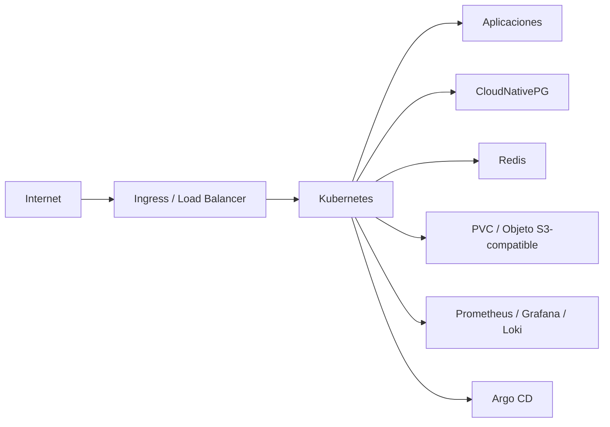

# Arquitectura objetivo

## Modelo

## Separación

- Plano de control administrado o evaluado mediante ADR.
- Nodos generales para aplicaciones.
- Nodos de servicios para workers y mensajería.
- Nodos multimedia para Jitsi.
- Bases de datos dentro de Kubernetes o administradas solo cuando exista ventaja aprobada.

## Seguridad

- Subredes privadas para nodos y datos.
- Subredes públicas únicamente para entrada controlada.
- NAT evaluado por costo y necesidad.
- IAM de mínimo privilegio.
- Identidades separadas por ambiente.
- Cifrado en tránsito y reposo.
- Network Policies y RBAC.

## Portabilidad

Las aplicaciones no dependerán obligatoriamente de APIs AWS. DNS, almacenamiento de objetos y secretos deberán tener alternativas documentadas.
