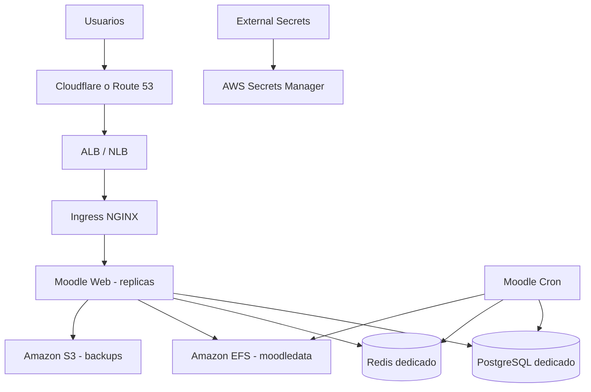

# Arquitectura AWS de referencia

## Componentes

## Cómputo

EKS reutiliza el patrón de clúster, node pools y GitOps del repositorio. Los workloads de Moodle se despliegan en el namespace `elearning`.

- Moodle Web: mínimo 2 réplicas en producción para actualización gradual y tolerancia a caída de un pod.
- Moodle Cron: 1 réplica, con concurrencia controlada.
- Requests y limits definidos después de medir carga.
- EKS con AWS Load Balancer Controller.

## Datos

- PostgreSQL dedicado mediante CloudNativePG como opción portable inicial.
- RDS PostgreSQL como alternativa administrada para producción.
- Redis dedicado dentro de Kubernetes en desarrollo/staging y evaluación de ElastiCache en producción.
- EFS con modo RWX para `moodledata` compartido.
- EBS gp3 para almacenamiento local de PostgreSQL.
- S3 con cifrado, bloqueo público y versiones habilitadas para backups.

## Seguridad

- Namespace separado y NetworkPolicies restrictivas.
- PostgreSQL y Redis sin exposición pública.
- IRSA o identidad equivalente por ServiceAccount.
- AWS Secrets Manager para secretos de Moodle, PostgreSQL y Redis.
- TLS mediante cert-manager.
- IAM de mínimo privilegio para lectura/escritura S3 solo por backup e integraciones aprobadas.
- No se almacenarán datos clínicos de YoSoy en Moodle.

## Multi-tenancy

IOMAD aporta separación funcional de usuarios, cursos, matrículas, roles, reportes y configuración por organización. Los tenants no tendrán bases de datos ni namespaces separados salvo aprobación posterior y requisitos concretos.

## Portabilidad

El diseño evita acoplamiento obligatorio:

- PostgreSQL portable mediante CloudNativePG.
- Redis compatible con clientes estándar.
- EFS se reemplaza por almacenamiento RWX compatible en DigitalOcean.
- S3 requiere una API compatible y configuración de credenciales equivalente.
- Route 53 puede reemplazarse por Cloudflare sin cambiar el workload.
